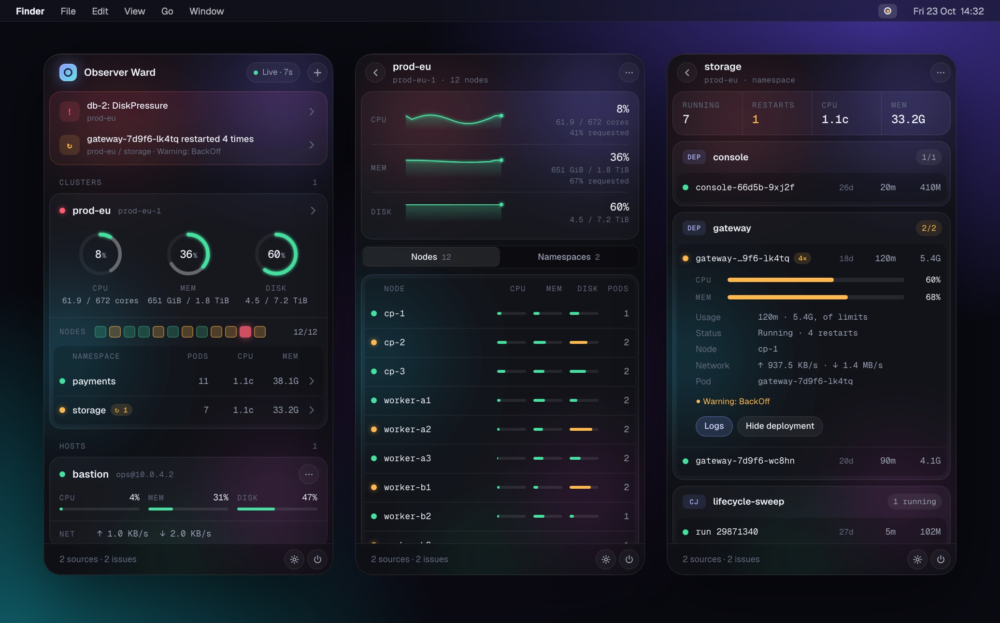
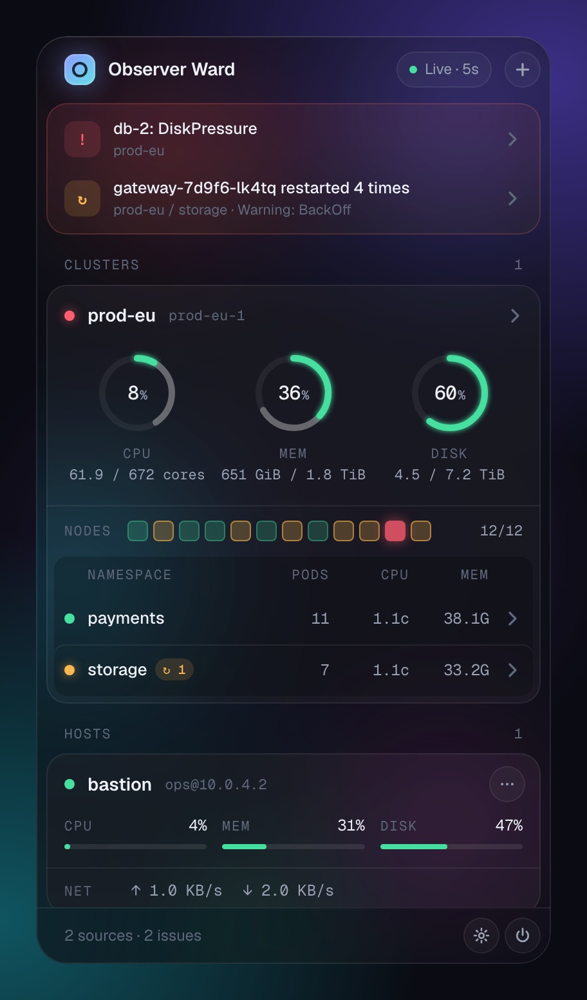
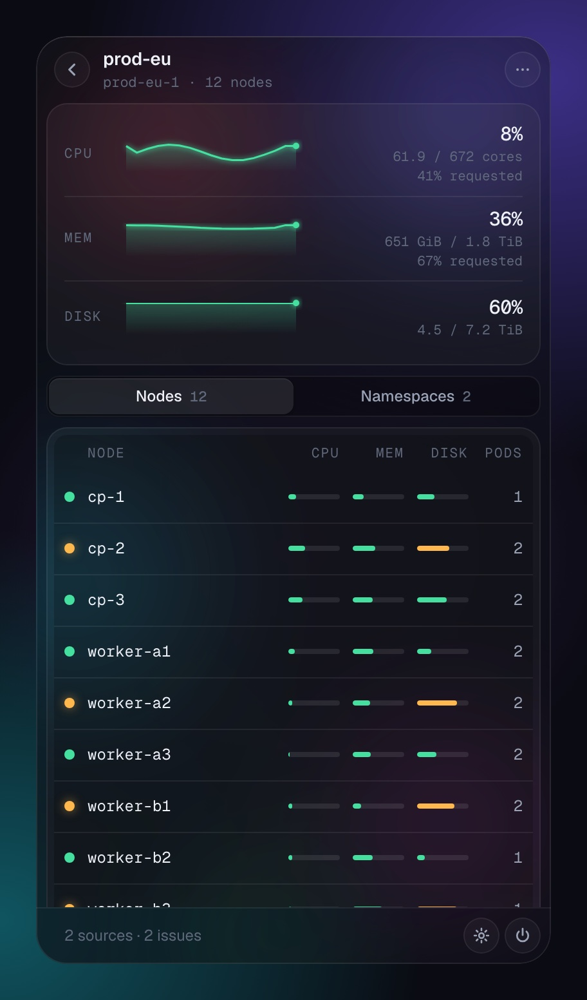
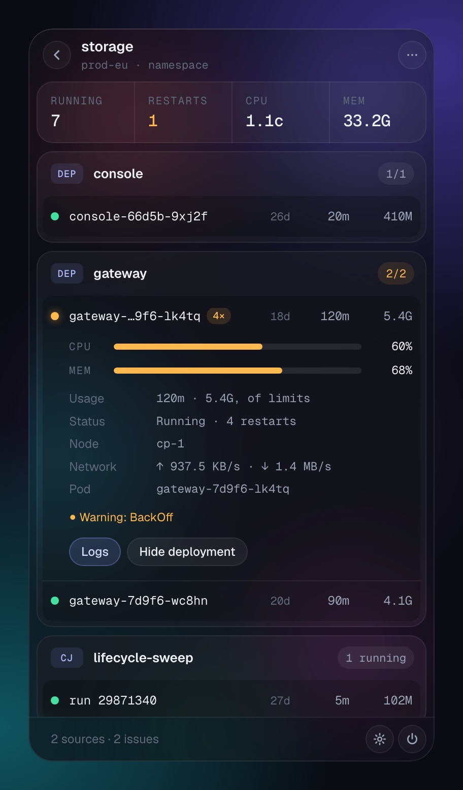
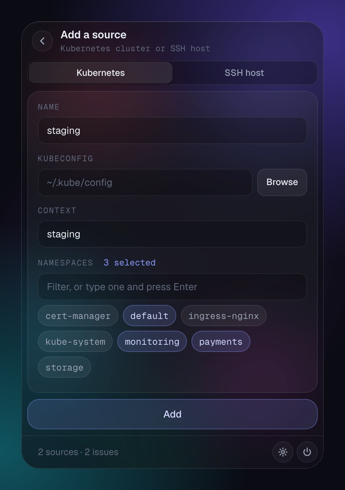

<h1 align="center">Observer Ward</h1>

<p align="center">
  Kubernetes clusters, SSH hosts and Grafana alerts, one click away in the macOS menu bar.
</p>

<p align="center">
  <a href="https://github.com/GeorgiosDelkos/observer-ward/actions/workflows/ci.yml"></a>
  
  
  <a href="LICENSE"></a>
</p>

<p align="center">
  
</p>

Observer Ward lives in the menu bar, with no Dock icon. It polls your clusters and hosts in the background and shows what needs a look first: a node under disk pressure, a pod that keeps restarting, a host near capacity, a firing Grafana alert. Click the tray icon for the popover; click away to dismiss it. The tray icon changes colour when something crosses a threshold, so you can tell without opening anything.

Built with [Tauri](https://tauri.app/) 2, Rust and plain JavaScript. The frontend has no bundler and no framework.

## What you see

<table>
  <tr>
    <td width="33%" valign="top"></td>
    <td width="33%" valign="top"></td>
    <td width="33%" valign="top"></td>
  </tr>
  <tr>
    <td valign="top"><b>Overview</b><br>Anything that needs attention, then one card per cluster (rings for CPU, memory and disk; the faint arc is what pods have requested), one cell per node, and a row per watched namespace. SSH hosts follow.</td>
    <td valign="top"><b>Cluster</b><br>Usage over the last polls, with requested capacity. Every node with its health, roles, kubelet version, usage and the pods it runs, or the list of watched namespaces.</td>
    <td valign="top"><b>Namespace</b><br>Pods grouped by the workload that owns them, with a ready count. Open a pod for its usage against its limits (or its node, for a pod without limits), node, volume, network, last event, logs, and a button to hide it.</td>
  </tr>
</table>

**Needs attention** collects offline sources, nodes that are not ready or under pressure, pods that are failing or that the app saw restart in the last hour, anything at 85% or more, and firing Grafana alerts. Each item opens the page that shows it.

Colour only ever means state: green below 60%, amber from 60%, red from 85%.

<sub>Screenshots show the app's own UI rendered with example data.</sub>

## Features

- **Kubernetes:** one entry per cluster, watching any number of namespaces. Cluster totals and requested capacity, per-node health (ready, cordoned, memory, disk and PID pressure) and usage, and per-pod metrics grouped by workload (restarts, age, PVC usage, latest event).
- **SSH hosts:** CPU, memory, disk and network over key-based SSH.
- **Grafana alerts:** firing alerts in the attention list, with native notifications. The API token stays in the macOS Keychain.
- **Notifications:** optional native notifications when a cluster, node, pod or host crosses a threshold.
- **Hide noise:** hide a workload (Deployment, StatefulSet, DaemonSet, CronJob, Argo Rollout) so its pods leave the list, the tray icon and notifications. It stays hidden across restarts and rollouts.
- **Two poll rates:** fast while the popover is open, slow while it is hidden. Unreachable targets back off instead of being retried every poll, and connections are reused across polls.
- **Open at login**, if you want it.

## Install

You need macOS (Apple Silicon or Intel), [Rust](https://rustup.rs/) (this repo pins 1.98.0 via `rust-toolchain.toml`), the Xcode Command Line Tools (`xcode-select --install`), and the Tauri CLI.

```sh
git clone https://github.com/GeorgiosDelkos/observer-ward.git
cd observer-ward
cargo install tauri-cli --version "^2"
cargo tauri build --bundles dmg
```

The disk image is written to `src-tauri/target/release/bundle/dmg/`. Drag **Observer Ward.app** to Applications.

The build is ad-hoc signed. On first launch, Control-click the app and choose **Open**, or run:

```sh
xattr -cr "/Applications/Observer Ward.app"
```

For development, `cargo tauri dev` runs the app from source. Edits under `ui/` are picked up on the next window load; there is no hot reload.

## Usage

### Add a Kubernetes cluster



1. Click **+** and keep **Kubernetes**.
2. Name the cluster. Leave the kubeconfig blank to use `~/.kube/config`, or click **Browse** to pick a file. **Context** suggests the kubeconfig's contexts and starts on its current one.
3. Pick one or more namespaces from the list, or type one and press Enter. Then click **Add**.

Adding checks that the kubeconfig can be read and that the context resolves to a cluster, so a typo is reported in the form instead of being saved. If a cluster goes offline later, its card says why; **⋯ → Copy error** copies the full message.

A cluster is one entry however many namespaces it watches. Picking a context that is already configured adds the namespaces to that cluster, and the form says which one. To watch another namespace later, use **+ Watch another namespace** on the cluster page. To stop watching one, use **⋯ → Stop watching** on its page. A cluster keeps at least one namespace; remove the cluster to drop the last.

The cluster needs [Metrics Server](https://github.com/kubernetes-sigs/metrics-server) and a kubeconfig that can read nodes, pods, events and the metrics API, plus `list` on Jobs to hide CronJobs. With `list` on pods in all namespaces, the cluster also shows how much CPU and memory its pods request. With `list` on namespaces, the add form offers them. Without either permission, that part is simply left out.

<br clear="right">

### Hide pods

Open a pod and click **Hide**. This hides the workload that owns the pod, or the pod itself by name if it has no controller, so it stays hidden across restarts and rollouts. Hidden pods are left out of the list, the tray icon and threshold notifications. Grafana alerts about them still fire. Nothing changes in the cluster.

Workloads are hidden per namespace. The namespace page then shows **N hidden workloads**; click it and choose **Show** to bring one back. Hidden pods are skipped as soon as they are listed, so no further work is done for them.

CronJob pods are matched to their CronJob through one list of the namespace's Jobs, refreshed only when a new run appears. Without permission to list Jobs, runs of a hidden CronJob are matched by their default name (`<cronjob>-<digits>`) instead.

### Add an SSH host

1. Click **+** and choose **SSH host**.
2. Fill in **Name**, **Host**, **Port**, **User** and **Private key** (for example `~/.ssh/id_ed25519`).
3. Click **Add**.

Password authentication is not supported. The remote host must provide `top`, `free`, `df` and `/proc/net/dev`.

### Grafana alerts

1. In Grafana, create a service-account token that can read alerts.
2. Open **Settings**, turn on **Show firing alerts**, enter the base URL and paste the token.
3. Save. Firing alerts appear under **Needs attention** on the next poll.

The token is stored in the macOS Keychain, never in `config.json`. Observer Ward only reads alerts; it never silences them. Alerts must be Grafana-managed (the client calls `/api/alertmanager/grafana/api/v2/alerts`). The URL must use `https://`, except for `localhost` and loopback addresses, because every request carries the token. To rotate the token, paste the new one in Settings and save.

### Settings and the rest

The gear in the footer opens Settings:

- **While open:** poll period while the popover is open (5–120 s, default 10).
- **While hidden:** poll period while it is hidden (30–600 s, default 300).
- **Open at login.**
- **Notify at thresholds:** native notifications when a metric turns amber or red.
- **Grafana alerts:** on or off, URL, API token, TLS verification.

Double-click a cluster or host name to give it a display name. The **⋯** menus hold the copy, terminal and remove actions. To remove a cluster or host, use **⋯ → Remove** and confirm. This cannot be undone, but you can add the target again.

## Configuration

`~/Library/Application Support/observer-ward/config.json` on macOS (`~/.config/observer-ward/config.json` on Linux)

```json
{
  "foreground_poll_secs": 10,
  "background_poll_secs": 300,
  "notifications_enabled": false,
  "grafana": {
    "name": "default",
    "url": "https://grafana.internal",
    "verify_tls": true,
    "enabled": true
  },
  "servers": [
    {
      "type": "k8s",
      "name": "production",
      "context": "prod-ctx",
      "kubeconfig": null,
      "namespaces": [
        { "name": "default" },
        { "name": "s3", "hidden": [{ "kind": "CronJob", "name": "sweep" }] }
      ]
    },
    {
      "type": "ssh",
      "name": "web-server-1",
      "host": "10.0.1.50",
      "port": 22,
      "user": "deploy",
      "key_path": "~/.ssh/id_ed25519"
    }
  ]
}
```

Files from before clusters held several namespaces have one `namespace` (and `hidden`) per entry; entries that share a kubeconfig and context are merged into the first on load, which keeps its name, and the file is rewritten in the new shape on the next save.

Every change made through the app is validated: new server names must be unique and must not contain `/`, a changed namespace list must be non-empty with unique names that do not contain `/`, and changed intervals must be 5–120 s (`foreground_poll_secs`) and 30–600 s (`background_poll_secs`). Existing entries that break these rules still load and do not block other edits. If the file cannot be read or parsed, the app starts with defaults and first copies it to `config.json.invalid`. The Grafana token is not in this file.

## Architecture

```
observer-ward/
├── rust-toolchain.toml     # Pins rustc 1.98.0 (also under src-tauri/)
├── docs/images/            # README screenshots
├── src-tauri/              # Rust / Tauri
│   └── src/
│       ├── lib.rs              # Crate root: Tauri builder, run()
│       ├── commands.rs         # IPC commands
│       ├── tray.rs             # Tray icon, popover show/hide
│       ├── terminal.rs         # Open ssh/kubectl in Warp or Terminal
│       ├── config.rs           # Config models and persistence
│       ├── error.rs            # Error-chain formatting
│       ├── metrics.rs          # Per-kind report types, levels, alerts
│       ├── poller.rs           # Poll loop, backoff, tray icon
│       ├── k8s.rs / k8s/       # Per-cluster collector: nodes, requests, pods per namespace
│       ├── ssh.rs / ssh/       # SSH session, TOFU, command parsers
│       └── grafana.rs          # Grafana Alertmanager alerts
├── tests/ui/               # Node tests for the UI model and formatting
└── ui/                     # Vanilla JS / HTML / CSS, native ES modules
    ├── index.html
    ├── app.js              # Navigation, actions, menus, sheets, Tauri events
    ├── styles.css          # Night Glass: 22px text edge, concentric corners, glass and glow
    ├── fonts/              # Geist and Geist Mono (OFL), bundled for the CSP
    └── js/
        ├── format.js       # Number, size, age and name formatting
        ├── model.js        # State, history, restarts, health, attention list
        ├── view.js         # Overview, cluster and namespace pages
        └── forms.js        # Add and settings pages
```

The poll loop collects every server in parallel, then emits Tauri events. The UI folds them into its model and re-renders the current page.

## Development

```sh
cd src-tauri
cargo test
cargo fmt --all -- --check
cargo clippy --all-targets --all-features -- -D warnings
cargo deny check
cd .. && node --test tests/ui/*.test.mjs   # UI model and formatting
```

Clippy denies `unwrap`, `panic`, `todo`, and `dbg!` in production code. Logging uses `tracing`.

## Security

See [SECURITY.md](SECURITY.md). Report vulnerabilities via GitHub private advisories.

## License

[MIT](LICENSE)
